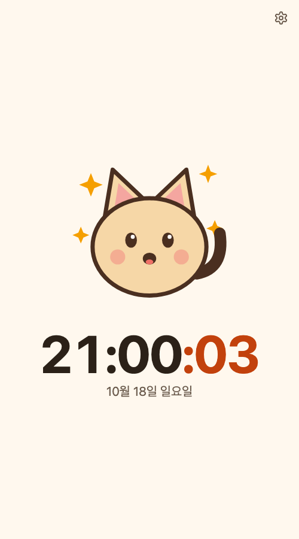
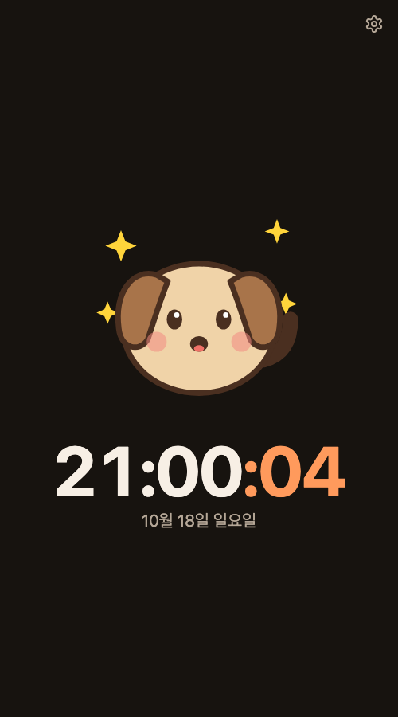
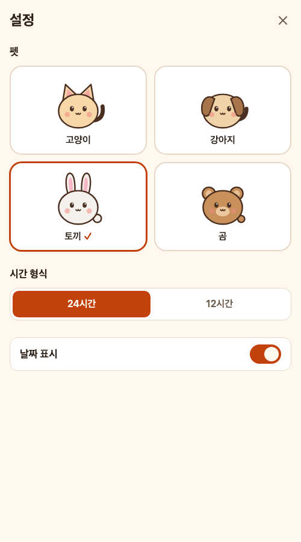

# Clock Pet

[](https://github.com/taeksoolee/clock-pet/actions/workflows/deploy.yml)
[](LICENSE)

> **English summary** — A tiny PWA clock that shows the time down to the second, with a cute pet that reacts to
> the clock (fidgets in the last seconds of every minute, celebrates on the hour, dozes at night).
> Built because the iPhone status bar clock has no seconds. Vanilla TypeScript + Vite, static site on GitHub Pages.
> UI is in Korean. Try it: <https://clock-pet.taeksoolee.com>

초 단위까지 보여주는 귀여운 펫 시계 PWA.
iPhone 상태바 시계에는 초가 없어서, 홈 화면에서 탭 한 번에 `16:59:42` 를 보려고 만들었다.

**👉 <https://clock-pet.taeksoolee.com>**

<p>
  
  
  
</p>

## 홈 화면에 추가 (iPhone)

1. Safari 로 <https://clock-pet.taeksoolee.com> 을 연다.
2. 공유 버튼 → **홈 화면에 추가**.
3. 이제 아이콘을 누르면 주소창 없는 전체 화면으로 바로 시계가 뜬다. 오프라인에서도 열린다.

Android Chrome 은 메뉴 → **앱 설치** (또는 홈 화면에 추가).

## 기능

- **초 단위 시계** — 매초 현재 시각을 다시 읽어서, 앱을 닫았다 열어도 어긋나지 않는다.
- **펫 4종** — 고양이 · 강아지 · 토끼 · 곰. 시계에 맞춰 반응한다.
  - 평소: 숨쉬기, 눈 깜빡임, 매초 꼬리 흔들기
  - 매분 55초부터: 입을 벌리고 들썩
  - 정각 (xx:00:00 ~ 04): 점프와 반짝이
  - 23 – 6시: 졸기 (Zzz)
- **화면 켜짐 유지** — 화면 보호기처럼, 시계를 띄워 둔 동안 화면이 꺼지지 않는다 (Screen Wake Lock API).
  앱을 닫거나 다른 앱으로 가면 자동으로 풀린다. 켜 둔 동안에는 OLED 번인을 막으려고 화면을 1분마다 몇 px 씩 옮긴다.
  iOS 저전력 모드에서는 시스템이 허용하지 않을 수 있다.
- **설정** (오른쪽 위 ⚙️) — 펫, 24 / 12 시간제, 날짜 표시, 화면 켜짐 유지. 바꾸는 즉시 저장된다.
- **반응형** — 320px 폰부터 가로 모드까지. 노치·다이내믹 아일랜드 영역을 피한다.
- **접근성**
  - VoiceOver 가 시계를 "17시 8분 17초" 로 읽는다 (매초 읽어 시끄럽지 않게 포커스할 때만).
  - 펫 상태를 텍스트로 알려준다 ("고양이가 졸고 있어요").
  - iOS 동작 줄이기 → 애니메이션 없이 표정만 바뀐다. 텍스트 크기 설정 · 다크 모드를 따른다.
  - 설정 화면은 네이티브 `<dialog>` — 포커스 가둠, Esc 로 닫기, 닫으면 포커스 복귀.

## 개발

```sh
npm install
npm run dev     # 개발 서버
npm run build   # dist/ 정적 빌드 (tsc 타입 검사 포함)
npm run icons   # public/pet.svg 를 고친 뒤 PWA 아이콘 재생성
```

의존성은 빌드 도구뿐이다 (Vite, TypeScript, vite-plugin-pwa). 런타임 라이브러리는 없다.

| 파일 | 역할 |
|---|---|
| [`src/time.ts`](src/time.ts) | 시간 계산. iOS Safari 가 Temporal 을 지원하면 여기만 바꾸면 된다 |
| [`src/pet.ts`](src/pet.ts) | 펫 정의 · SVG · 상태 머신 |
| [`src/settings.ts`](src/settings.ts) | 설정 저장 (localStorage, 실패해도 기본값으로 동작) |
| [`src/wake-lock.ts`](src/wake-lock.ts) | 화면 켜짐 유지 (보일 때 다시 요청) |
| [`src/main.ts`](src/main.ts) | 렌더 루프 · 설정 화면 |

### 펫 추가하기

[`src/pet.ts`](src/pet.ts) 의 `PETS` 에 항목 하나를 넣으면 설정 화면에도 자동으로 나온다.
몸통 · 얼굴 · 표정 · 애니메이션은 공유하고 귀 (`ears`) · 꼬리 (`tail`) · 색만 정의한다.

## 배포

`main` 에 push 하면 [GitHub Actions](.github/workflows/deploy.yml) 가 빌드해서 GitHub Pages 로 배포한다
(커스텀 도메인 `clock-pet.taeksoolee.com`). 이미 설치한 PWA 는 다음 실행 때 새 버전을 받는다.

## 라이선스

[MIT](LICENSE)
